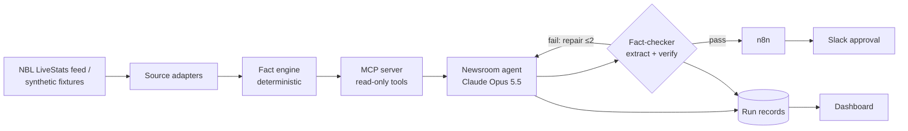

# NBL Media Desk

**An AI post-game newsroom that can't get the numbers wrong.**

When the final siren sounds, NBL Media Desk turns the official box score into a club-ready content package (match recap, social posts, player of the game, press-conference questions) in the club's voice. **Every number and factual claim is checked against the box score before a human sees it**, and nothing is published without one-click approval.

[](https://github.com/millerharry/nbl-media-desk/actions/workflows/ci.yml)
[](LICENSE)


> 🎬 **Demo GIF coming in v0.1:** final siren → verified recap in Slack.

---

## Why

Club media teams have about 30 minutes after a game to publish. LLMs can draft in seconds, but they invent statistics, and one wrong number under a club's name costs more trust than the time it saved. This project treats **grounding as an engineering problem**, not a prompt:

1. **A deterministic fact engine** computes every number. The model never does arithmetic.
2. **The writer cites fact IDs** for every claim, using structured outputs.
3. **An independent fact-checker** extracts claims from the final text and verifies each one *in code*.
4. **Mutation-tested evals** prove the checker catches injected errors.

## Architecture



Full design: [`docs/design.md`](docs/design.md) · Decisions: [`docs/adr/`](docs/adr/) · Data research: [`docs/research/data-sources.md`](docs/research/data-sources.md)

## Quickstart

> ⚠️ Pre-alpha: the scaffold is in place; the pipeline lands over the Phase 3 milestones below.

```bash
# Requirements: Python 3.12+, uv (https://docs.astral.sh/uv/)
git clone https://github.com/millerharry/nbl-media-desk && cd nbl-media-desk
make install
cp .env.example .env   # add ANTHROPIC_API_KEY for live runs
make check             # lint, types, tests, data guard
uv run nbl-desk facts game-001          # fact sheet for the synthetic golden game
uv run nbl-desk facts 2120057 --source livestats   # a real NBL game, fetched once into .cache/
```

## Roadmap

| Milestone | Scope | Status |
|---|---|---|
| Design | Design doc, ADRs, data research | ✅ |
| Scaffold | Tooling, CI, community files, golden set | ✅ |
| v0.1 core | ✅ Canonical model, adapters and fact engine (3a) → MCP server → agent → fact-checker → evals | ⏳ |
| v0.2 integrations | Final-siren watcher, n8n workflow, Slack approval | |
| v0.3 monitoring | Dashboard: fact-check failure rate, $/game, p95 latency, cache hit rate | |
| v1.0 | Demo, docs polish, tagged release | |

## Tech

Python 3.12+ · [Anthropic Python SDK](https://github.com/anthropics/anthropic-sdk-python) (Claude Opus 5.5 / Haiku 5.5, structured outputs, prompt caching) · [MCP Python SDK](https://github.com/modelcontextprotocol/python-sdk) · Pydantic v2 · uv · ruff · mypy --strict · pytest · n8n · GitHub Actions

## Data and trademarks

This repository contains **no third-party game data**: tests and public evals use fictional teams and players ([ADR-0006](docs/adr/0006-no-third-party-data-in-repo.md)). Real NBL data is fetched on demand for personal, non-commercial development use and cached locally; commercial use requires a licence from the data owner.

NBL Media Desk is an independent project and is not affiliated with, endorsed by or sponsored by the National Basketball League, its clubs, Genius Sports or FIBA. "NBL" and club names are trademarks of their respective owners.

## Contributing

See [CONTRIBUTING.md](CONTRIBUTING.md), the [Code of Conduct](CODE_OF_CONDUCT.md) and [SECURITY.md](SECURITY.md).

## Licence

[Apache-2.0](LICENSE)
