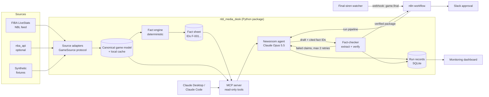

# NBL Media Desk: design

| | |
|---|---|
| **Status** | Approved (decisions recorded in ADR-0001, 0002, 0008, 0009) |
| **Author** | Harry Miller |
| **Last updated** | 2026-11-08 |
| **Decisions** | [`docs/adr/`](adr/) |
| **Data research** | [`docs/research/data-sources.md`](research/data-sources.md) |

## 1. Summary

NBL Media Desk is an AI post-game newsroom. When a game ends it builds a verified fact sheet from the official stats, finds the stories worth telling, and drafts a content package in a club's voice: match recap, social posts, player of the game, and press-conference questions. **Every number and factual claim is checked against the box score before a human ever sees the draft**, and nothing is published without one-click human approval.

The project is open source and built as a production-quality reference for grounded LLM content generation.

## 2. Problem

Club media teams have about 30 minutes after the final siren to get a recap and a set of social posts out. Writers comb through the box score and play-by-play under time pressure. Generic LLMs can draft quickly but invent statistics, and one wrong number published under a club's name costs more trust than the time it saved. **The core problem isn't generating text. It's generating text that's provably correct.**

## 3. Goals and non-goals

### Goals
1. **G1, grounded:** every numeric or factual claim in the output traces to a fact in the game data. Target: 0 unverified numeric claims in approved output, and fact-checker recall ≥ 98% on injected errors (§8).
2. **G2, useful:** drafts a media manager would publish with light edits. Measured by human and rubric scores on storyline quality and tone.
3. **G3, fast:** full package in < 3 minutes (p95) after the final siren.
4. **G4, safe by default:** human approval before anything leaves the system, no secrets in the repo, no raw third-party data in the repo.
5. **G5, observable:** every run records latency, tokens, cost, cache hit rate and fact-check results per stage.
6. **G6, textbook open source:** typed, tested, documented, reproducible, and easy to contribute to.

### Non-goals (v1)
- Auto-publishing to social platforms. Humans publish.
- Live in-game commentary. Post-game only.
- Video, images or graphics generation.
- Being a stats website or a general basketball chatbot.
- Any commercial use of NBL data (needs a data licence; see §12).

## 4. Users and use cases

| User | Need |
|---|---|
| Club media manager | A publish-ready draft package within minutes of the siren, in the club's voice |
| League or broadcast producer | Storylines and press questions for post-game shows |
| Developer or analyst | An MCP server to query game data from Claude Desktop or Claude Code |

## 5. Architecture

### Components

| Component | Responsibility | Notes |
|---|---|---|
| **Source adapters** | Fetch raw data and map it to the canonical model | `GameSource` protocol; `FixtureSource`, `LiveStatsSource`, `NbaApiSource` ([ADR-0001](adr/0001-canonical-model-and-source-adapters.md)) |
| **Canonical game model** | Typed Pydantic models: `Game`, `Team`, `PlayerLine`, `PlayEvent` | Source-agnostic. Everything downstream depends only on this |
| **Cache** | Local, git-ignored store of fetched games | Polite access: one fetch per finished game ([ADR-0006](adr/0006-no-third-party-data-in-repo.md)) |
| **Fact engine** | Computes every number the writer may use: leaders, runs, quarter swings, lead changes, shooting splits, records and highs from history | Pure Python, fully unit-tested. **LLMs never do arithmetic** ([ADR-0003](adr/0003-deterministic-fact-sheet.md)) |
| **MCP server** | Exposes read-only tools over games and fact sheets | Used by the agent and directly by humans in Claude Desktop or Claude Code |
| **Newsroom agent** | Finds storylines, then writes each content piece with fact-ID citations | Claude API via the Anthropic SDK ([ADR-0002](adr/0002-language-and-agent-runtime.md)) |
| **Fact-checker** | Independently extracts claims from the final text and verifies each one in code | [ADR-0004](adr/0004-fact-check-architecture.md) |
| **Final-siren watcher** | Polls live games and emits `game.final` when the `game/end` event appears | No public push feed exists, so we create the webhook ourselves |
| **n8n workflow** | Orchestrates watcher → pipeline → Slack approval | Workflow JSON is versioned in the repo |
| **Run records and dashboard** | Persist per-stage metrics and show them | [ADR-0007](adr/0007-observability.md) |

## 6. Data flow (one game)

1. **Trigger.** The watcher sees `pbp[0].actionType == "game" && subType == "end"` and posts `game.final {game_id}` to n8n. Locally it's simply `nbl-desk run --game 2120057`.
2. **Ingest.** The adapter fetches once, validates against the canonical model (strict Pydantic: an unknown shape fails loudly) and writes to the cache.
3. **Facts.** The fact engine produces a `FactSheet`: an ordered list of facts with stable IDs, for example
   `F-014 | player | Kendric Davis | points | 28 | scope=game | "Kendric Davis scored 28 points"`.
4. **Storylines.** The agent reads the fact sheet through MCP tools and ranks 3–5 storylines. Each storyline must cite fact IDs.
5. **Write.** For each output type (recap, three social posts, player of the game, press questions) the agent produces structured output: text plus `claims[]`, each claim with its fact IDs. The club voice comes from a versioned style guide (`styles/<club>.md`).
6. **Fact-check.** See §7. Failures go back to the writer with precise feedback, up to two repair rounds. Anything still unverified is removed or flagged for a human.
7. **Deliver.** The verified package and a fact-check report go to n8n, which posts to Slack with Approve, Edit and Reject buttons. Nothing is published automatically.
8. **Record.** Every stage writes a run record: timings, model, tokens, cost, cache reads, claim counts and pass/fail.

## 7. Fact-check approach

The writer's own citations are useful but can't be trusted on their own: a model can cite F-014 and still write "31 points". So verification is **independent and deterministic wherever possible**.

1. **Constrain at generation.** The writer only gets the fact sheet, never raw arithmetic tasks. Its structured output must attach fact IDs to every claim.
2. **Independent extraction.** A separate, cheaper model call (Claude Haiku 5.5 or Sonnet 5.5, with structured outputs) reads only the final text and lists every factual assertion as a typed claim:
   `{ subject, metric, value, scope, comparator?, span }`. It never sees the fact sheet, so it can't "agree" with the writer.
3. **Deterministic verification.** Code matches each claim to the fact sheet and canonical model:
   - numbers: exact match after normalising (`28`, "twenty-eight", "28pts")
   - percentages: within rounding tolerance (±0.5 pp)
   - comparatives and records ("season high", "first since 2023"): only when the fact engine produced that exact fact
   - entities: player, team and coach names resolved against the roster (no invented people)
4. **Coverage check.** Every claim the extractor finds must be verified, and every sentence span with a number must be covered by a claim. Numbers in text that no claim covers are treated as failures.
5. **Verdicts.** `verified`, `contradicted` (wrong value), `unsupported` (no matching fact) or `opinion` (allowed if it's clearly evaluative, e.g. "a statement win", and sits next to a supporting fact).
6. **Policy.** Any `contradicted` or `unsupported` claim blocks the piece. Then it's repair (max two rounds), then flag to a human with the failing spans highlighted.

This is the project's main engineering idea, and the evals in §8 measure it directly.

## 8. Evaluation strategy

All evals are runnable with one command (`make eval`) and report to `evals/results/`.

| Suite | What it measures | Method |
|---|---|---|
| **Fact engine unit tests** | Correctness of every derived number | pytest against hand-computed fixtures |
| **Fact-checker recall (mutation testing)** | Does the checker catch wrong facts? | Take verified drafts and inject known errors (wrong number, wrong player, swapped team, invented record, wrong comparative). Target ≥ 98% caught |
| **Fact-checker precision** | Does it block correct text? | Run on human-verified correct drafts. Target ≤ 2% false blocks |
| **End-to-end groundedness** | Unverified claims in final output | Full pipeline on the golden set. Target 0 unverified numeric claims |
| **Content quality** | Storyline selection, tone, readability, platform fit | LLM-judge rubric (Claude Opus 5.5) calibrated against human scores; agreement reported |
| **Format compliance** | Schema validity, length limits, hashtags, no banned content | Deterministic checks |
| **Cost and latency** | $/game, p50/p95 seconds | From run records |

**Golden set.** `evals/golden/` holds synthetic games (safe to commit), each with an expected fact sheet and annotated "must mention" storylines. A local-only set of real NBL games lives in the git-ignored cache. Prompt changes are compared on a fixed train/test split so we aren't tuning against the test set.

## 9. Models and cost

| Stage | Model | Why |
|---|---|---|
| Storylines and writing | `claude-opus-5-5`, adaptive thinking, effort `high` | Quality matters most here |
| Claim extraction | `claude-haiku-5-5` or `claude-sonnet-5-5` (decided by eval) | High volume, narrow task, cheap |
| Quality judge (evals only) | `claude-opus-5-5` | Judge should be at least as capable as the writer |

- **Prompt caching:** system prompt, style guide and tool definitions are frozen and cached. The game fact sheet comes after the cache breakpoint.
- **Refusal handling:** check `stop_reason` and use the server-side `fallbacks: "default"` option for Opus 5.5.
- **Rough cost:** about 30k input and 8k output tokens per game on Opus 5.5 ($4 / $20 per MTok), so roughly **$0.30 per game** before caching. A full NBL regular season (~140 games) costs under $50.

## 10. Observability

- **Run records** (SQLite, one row per stage per run): run ID, game ID, stage, model, input/output/cache tokens, cost, latency, verdict counts, error.
- **Structured JSON logs** with a run ID on every line. OpenTelemetry spans per stage are optional and off by default.
- **Dashboard (Phase 3):** fact-check failure rate, repairs per piece, $/game, p95 latency, cache hit rate, approval rate from Slack.
- **Alerts:** a run over budget, more than two repairs, or a source schema validation failure (feed format changed).

## 11. Security and responsible AI

- **Secrets:** only in environment variables (`.env` is git-ignored; `.env.example` is committed). Secret scanning runs in CI.
- **Least privilege:** the MCP server is read-only. The agent has no shell, filesystem or web tools, only the game tools.
- **Prompt injection:** feed strings (names, officials) are treated as data, never instructions. They're passed in structured fields and length-checked.
- **Human in the loop:** nothing is published automatically. Slack approval is required, and every approval is logged.
- **Accuracy:** the fact-check gate (§7). Flagged content is never silently dropped; it goes to the human with a reason.
- **Fair content about real people:** stats-based commentary about professional athletes only. No speculation about injuries, personal lives, conduct or betting. A policy check for these topics runs in the format suite.
- **Transparency:** drafts carry an "AI-assisted, human-approved" note for the club to keep or remove according to its own policy.
- **Data and IP:** no raw third-party data or logos in the repo. Access is polite and cached. Commercial use needs a licence (§12).
- **Supply chain:** pinned, locked dependencies; Dependabot; CI on every PR; signed release tags.

## 12. Risks and open questions

| # | Risk / question | Mitigation / owner |
|---|---|---|
| R1 | NBL feed is undocumented and may change | Strict validation with loud failure; adapter isolation; contract tests on cached samples |
| R2 | No licence for NBL data reuse | Personal non-commercial use only; no data in the repo; seek a licence before any product use |
| R3 | **"NBL" is a trademark.** A product named "NBL Media Desk" could draw objections | Keep the name for the portfolio repo; rename the product (league-neutral) before any commercial launch |
| R4 | Fact-checker misses subtle comparative claims | Comparatives are only allowed when the fact engine produced them; mutation suite covers them |
| R5 | LLM-judge bias | Calibrate against human labels; report agreement; never the only gate |
| Q1 | Which club styles ship by default? | Start with one neutral house style plus one sample club style |

## 13. Phased plan

| Phase | Deliverable |
|---|---|
| **1. Design (this doc)** | Design doc, ADRs, data research |
| **2. Scaffold** | Repo, tooling, CI, community files, placeholder tests, golden-set skeleton |
| **3a. Data and facts** | Canonical model, fixture and LiveStats adapters, cache, fact engine (fully tested) |
| **3b. MCP server** | Read-only tools; usable from Claude Desktop |
| **3c. Agent** | Storylines and writers with structured, cited output |
| **3d. Fact-checker** | Extraction, verification, repair loop |
| **3e. Evals** | Mutation suite, golden set, quality rubric, `make eval` |
| **3f. n8n and Slack** | Watcher, workflow JSON, approval flow |
| **3g. Dashboard** | Metrics UI over run records |
| **v1.0** | Demo GIF, a real-game walkthrough, tagged release |
